# 3. Descripción del dataset

## Origen

El proyecto usa el dataset [Formula 1 World Championship (1950 -
2024)](https://www.kaggle.com/datasets/rohanrao/formula-1-world-championship-1950-2020) publicado en Kaggle por Rohan
Rao, **versión 24** (Rao, 2024). Contiene los resultados de todas las carreras del Campeonato Mundial de Fórmula 1 desde
1950 hasta 2024, a partir de los datos de la *Ergast Developer API* (Newell, s. f.).

Los 14 CSV originales están en `data/raw/` y son el **dataset inicial** del proyecto. Se trabaja directamente con esos
archivos, sin volver a descargarlos: el autor actualiza el dataset cada temporada y así cualquiera que ejecute los
notebooks obtiene exactamente los mismos datos. En los CSV los valores nulos aparecen como el texto `\N`, y los nombres
de columna están en *camelCase* (`raceId`); al leerlos se convierten en nulos y en *snake_case* (`race_id`).

## Archivos

En total son 701 433 filas y unos 21 MB, de los que `lap_times` ocupa 17.6 MB.

| Archivo | Filas | Columnas | Contenido | Fuente |
|---|---:|---:|---|---|
| `circuits` | 77 | 9 | Circuitos: nombre, ciudad, país y coordenadas | Base de datos |
| `constructors` | 212 | 5 | Escuderías | Base de datos |
| `drivers` | 861 | 9 | Pilotos: nombre, código, fecha de nacimiento y nacionalidad | Base de datos |
| `seasons` | 75 | 2 | Temporadas de 1950 a 2024 | Base de datos |
| `status` | 139 | 2 | Estado de llegada (*Finished*, *+1 Lap*, *Engine*, *Accident*, ...) | Base de datos |
| `races` | 1 125 | 18 | Grandes Premios: año, ronda, circuito, fecha y horarios | Base de datos |
| `results` | 26 759 | 18 | Resultado de cada piloto en cada carrera: salida, llegada, puntos, vueltas, estado | Base de datos |
| `sprint_results` | 360 | 16 | Resultados de las carreras sprint (desde 2021) | Base de datos |
| `qualifying` | 10 494 | 9 | Clasificación con los tiempos de Q1, Q2 y Q3 (desde 1994) | Base de datos |
| `driver_standings` | 34 863 | 7 | Campeonato de pilotos después de cada carrera | Base de datos |
| `constructor_standings` | 13 391 | 7 | Campeonato de constructores después de cada carrera | Base de datos |
| `constructor_results` | 12 625 | 5 | Puntos de cada escudería en cada carrera | Base de datos |
| `lap_times` | 589 081 | 6 | Tiempo de cada vuelta de cada piloto (desde 1996) | CSV |
| `pit_stops` | 11 371 | 7 | Cada parada en boxes, con su vuelta y duración (desde 2011) | CSV |

## Qué tablas van a la base de datos y cuáles quedan como CSV

La actividad pide trabajar con dos fuentes: un dataset en CSV y otro en una base de datos. Los archivos se repartieron
según su función:

| Criterio | Base de datos (12 tablas) | CSV (2 tablas) |
|---|---|---|
| Naturaleza | Catálogos y resultados por carrera, relacionados entre sí | Detalle fino: una fila por vuelta o por parada |
| Uso principal | Consultas que unen tablas, como *¿quién ganó en Monza en 2019?* | Agregaciones y gráficos de ritmo y estrategia |
| Integridad | Se benefician de claves primarias y foráneas | Solo se leen y se agregan |
| Cobertura | 1950 - 2024 | Desde 1996 (vueltas) y 2011 (paradas) |

`lap_times` tiene el 84 % de todas las filas del dataset, pero solo se usa agregado por piloto y carrera (mediana del
tiempo por vuelta), así que no gana nada al estar en la base de datos. `pit_stops` cumple el mismo papel para la
estrategia de paradas.

Como motor se eligió **SQLite**: no necesita un servidor, la base de datos es un único archivo que se versiona en
GitHub junto con el SQL (`data/f1.db`, unos 6 MB) y es suficiente para este volumen. Se descartaron PostgreSQL y MySQL
porque obligarían a instalar y configurar un servidor para reproducir el proyecto, sin ninguna ventaja para un análisis
de lectura. La conexión es de **solo lectura** para los notebooks, la API y el asistente.

## Diagrama entidad-relación

Las 12 tablas de la base de datos, con sus claves primarias (PK) y foráneas (FK). `results` es la tabla central: cada
fila une una carrera, un piloto, una escudería y un estado de llegada.

```mermaid
erDiagram
    seasons ||--o{ races : "year"
    circuits ||--o{ races : "circuit_id"
    races ||--o{ results : "race_id"
    drivers ||--o{ results : "driver_id"
    constructors ||--o{ results : "constructor_id"
    status ||--o{ results : "status_id"
    races ||--o{ sprint_results : "race_id"
    drivers ||--o{ sprint_results : "driver_id"
    constructors ||--o{ sprint_results : "constructor_id"
    status ||--o{ sprint_results : "status_id"
    races ||--o{ qualifying : "race_id"
    drivers ||--o{ qualifying : "driver_id"
    constructors ||--o{ qualifying : "constructor_id"
    races ||--o{ driver_standings : "race_id"
    drivers ||--o{ driver_standings : "driver_id"
    races ||--o{ constructor_standings : "race_id"
    constructors ||--o{ constructor_standings : "constructor_id"
    races ||--o{ constructor_results : "race_id"
    constructors ||--o{ constructor_results : "constructor_id"

    seasons {
        int year PK
        text url
    }
    circuits {
        int circuit_id PK
        text circuit_ref
        text name
        text country
        real lat
        real lng
    }
    races {
        int race_id PK
        int year FK
        int round
        int circuit_id FK
        text name
        text date
    }
    drivers {
        int driver_id PK
        text driver_ref
        text forename
        text surname
        text nationality
    }
    constructors {
        int constructor_id PK
        text constructor_ref
        text name
        text nationality
    }
    status {
        int status_id PK
        text status
    }
    results {
        int result_id PK
        int race_id FK
        int driver_id FK
        int constructor_id FK
        int status_id FK
        int grid
        int position_order
        real points
        int laps
    }
    sprint_results {
        int result_id PK
        int race_id FK
        int driver_id FK
        int constructor_id FK
        int status_id FK
    }
    qualifying {
        int qualify_id PK
        int race_id FK
        int driver_id FK
        int constructor_id FK
        int position
    }
    driver_standings {
        int driver_standings_id PK
        int race_id FK
        int driver_id FK
        real points
        int position
    }
    constructor_standings {
        int constructor_standings_id PK
        int race_id FK
        int constructor_id FK
        real points
        int position
    }
    constructor_results {
        int constructor_results_id PK
        int race_id FK
        int constructor_id FK
        real points
    }
```

Además hay dos **vistas** que simplifican las consultas más comunes:

- **`v_race_results`** (26 759 filas): el resultado de cada piloto en cada carrera con nombres legibles de carrera,
  circuito, piloto, escudería y estado.
- **`v_race_winners`** (1 128 filas): el ganador de cada carrera. Tiene tres filas más que carreras porque en tres
  carreras de los años 50 dos pilotos compartieron el coche ganador y ambos figuran como vencedores.

`lap_times` y `pit_stops` se relacionan con la base de datos por `race_id` y `driver_id`; al unirlas con los resultados,
todas las vueltas encontraron su carrera y su piloto.

## Dataset final

El notebook 02 genera `data/final/f1_dataset_final.csv`: **una fila por piloto y carrera** (solo pilotos que tomaron la
salida), de 1950 a 2024, con **25 146 filas y 39 columnas**. Es la entrada de los notebooks de clustering y
clasificación y de la API.

| Grupo | Columnas |
|---|---|
| Carrera | `race_id`, `year`, `round`, `race_date`, `race_name`, `era` (era reglamentaria) |
| Circuito | `circuit_id`, `circuit_ref`, `circuit_name`, `country` |
| Piloto | `driver_id`, `driver_ref`, `driver_name`, `driver_nationality` |
| Escudería | `constructor_id`, `constructor_ref`, `constructor_name` |
| Antes de la carrera | `grid` (posición de salida), `quali_position` (posición en la clasificación), `driver_races_before` (carreras anteriores), `driver_points_before` y `driver_rank_before` (puntos y puesto en el campeonato), `driver_form` (posición media en sus últimas 5 carreras), `driver_circuit_form` (posición media en ese circuito), `constructor_form` (posición media de la escudería en sus últimas 5 carreras) |
| Resultado | `position`, `position_order`, `points`, `points_2010` (puntos con el sistema de 2010), `laps`, `status`, `finished`, `is_win`, `is_podium`, `positions_gained` |
| Ritmo y paradas (CSV) | `median_lap_ms` (mediana del tiempo por vuelta), `pace_gap_pct` (diferencia con el más rápido de la carrera, en %), `pit_stops` (número de paradas), `mean_pit_ms` (duración media en el pit lane) |

Las columnas **antes de la carrera** solo usan información anterior a cada carrera: son las variables del clasificador
de podio. Las de **resultado** y **ritmo** describen la carrera ya disputada: sirven como variable objetivo o para el
perfil de los pilotos, nunca como entrada del clasificador.

Los nulos se explican por la cobertura de cada fuente: la clasificación existe desde 1994, las vueltas desde 1996 y las
paradas desde 2011; `driver_circuit_form` es nula la primera vez que un piloto corre en un circuito y
`driver_rank_before`, en la primera carrera de cada temporada.
